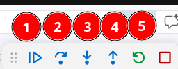
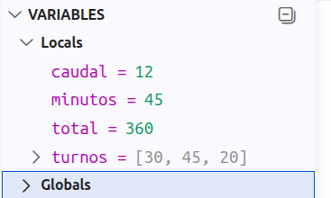

<!-- _class: title -->
<!-- _paginate: false -->

# 29. Debugging en VS Code

## Ejecutar un programa paso a paso

<div class="course">
Programación I<br>
Ingeniería Electrónica y Telecomunicaciones
</div>

<div class="meta">
Comisión 3<br>
Profesor: Lautaro Linquimán<br>
Universidad Nacional de Río Negro
</div>

<div class="unrn-logo">
  
  <span>UNIVERSIDAD<br>NACIONAL</span>
</div>

---

<!-- _class: inverse -->

# Repaso express

1. ¿Qué es el caso base de una función recursiva?
2. ¿Qué pasa si una función recursiva nunca llega al caso base?
3. ¿Cuándo conviene un `for` antes que la recursividad?

---

<!-- _class: compact -->

# ¿Qué es depurar?

Depurar (en inglés, debugging) es el proceso sistemático de encontrar, analizar y corregir errores (conocidos como bugs) en el código fuente de un programa de software.

<div class="columns">
<div>

```python
def riego_total(turnos, caudal):
    total = 0
    for minutos in turnos:
        print("total:", total)
        total += minutos * caudal
    return total

turnos = [30, 45, 20]
print(riego_total(turnos, 12))
```

</div>
<div>

```text
total: 0
total: 360
total: 900
1140
```

- Con `print()` agregamos código, elegimos de antemano qué mostrar y después hay que borrarlo.
- Con el depurador el código no cambia: el programa se frena donde marcamos y muestra todas las variables.

</div>
</div>

---

<!-- _class: compact -->

# Instalando las extensiones

<div class="columns">
<div>

VS Code usa dos extensiones de Microsoft:

| Extensión | Identificador |
|---|---|
| Python | `ms-python.python` |
| Python Debugger | `ms-python.debugpy` |

Se instalan desde Extensiones (Ctrl+Shift+X) buscando "Python". Al instalar Python se instala también Python Debugger.

</div>
<div>

Para verificar desde la terminal:

```bash
code --list-extensions | grep ms-python
```

Entre otras, tienen que aparecer:

```text
ms-python.debugpy
ms-python.python
```


</div>
</div>

> Para elegir el `.venv` del proyecto: Ctrl+Shift+P y **Python: Select Interpreter**.

---

<!-- _class: compact -->

# Nuestra primera sesión de debugging

Un **breakpoint** marca la línea donde el programa se frena.

<div class="columns">
<div>

```python
def riego_total(turnos, caudal):
    total = 0
    for minutos in turnos:
        total += minutos * caudal
    return total

turnos = [30, 45, 20]
print(riego_total(turnos, 12))
```

Archivo: [recursos/riego.py](../recursos/riego.py)

</div>
<div>

1. Clic a la izquierda del número de línea de `total += ...`, o F9 en esa línea. Aparece un punto rojo.
2. En la flecha del botón Run, elegir **Python Debugger: Debug Python File**. También se puede con F5.
3. El programa se frena en el breakpoint. La línea resaltada es la próxima a ejecutar: todavía no corrió.

</div>
</div>

---

<!-- _class: compact -->

# Controles del depurador

<div class="columns">
<div>



1. **Continue** (F5): sigue hasta el próximo breakpoint.
2. **Step Over** (F10): ejecuta la línea; si llama a una función, la ejecuta entera.
3. **Step Into** (F11): entra en la función que se llama en esa línea.
4. **Step Out** (Shift+F11): termina la función y vuelve a donde fue llamada.
5. **Restart** (Ctrl+Shift+F5) y **Stop** (Shift+F5).

</div>
<div>



Así se ve `riego.py` en la segunda vuelta del `for`. **Locals** son las variables de la función donde está frenado; **Globals**, las del archivo.

</div>
</div>

---

<!-- _class: compact -->

# Ejercicio guiado: promedio de temperaturas

<div class="columns">
<div>

```python
def limpiar(lecturas):
    for i, valor in enumerate(lecturas):
        if valor == -999:
            lecturas.pop(i)
    return lecturas

def promedio(lecturas):
    validas = limpiar(lecturas)
    suma = 0
    for valor in validas:
        suma += valor
    return suma / len(validas)

temperaturas = [18.5, -999, -999,
                21.0, 19.5, 23.0]
print(promedio(temperaturas))
```

</div>
<div>

El sensor guarda `-999` cuando no pudo medir. El programa muestra `-183.4` y el promedio de las mediciones válidas es `20.5`.

Archivo: [recursos/promedio_temperaturas.py](../recursos/promedio_temperaturas.py)

</div>
</div>

---

<!-- _class: compact -->

# Ejercicio: descuentos del almacén

<div class="columns">
<div>

```python
def total_compra(compra):
    total = 0
    descuento = 0
    for nombre in compra:
        precio, cantidad = compra[nombre]
        if cantidad >= 6:
            descuento = 0.15
        elif cantidad >= 3:
            descuento = 0.10
        subtotal = precio * cantidad
        total += subtotal * (1 - descuento)
    return total
```

Archivo: [recursos/descuentos_almacen.py](../recursos/descuentos_almacen.py)

</div>
<div>

```python
compra = {
    "Yerba": (4200, 1),
    "Alfajores": (900, 6),
    "Leche": (1500, 2),
    "Galletitas": (1100, 3),
    "Queso cremoso": (6000, 1),
}
print(total_compra(compra))
```

Llevando 3 o más unidades de un producto, ese producto tiene 10 % de descuento; con 6 o más, 15 %. Encontrar el error con el depurador y corregirlo.

**Salida esperada:** `20760.0`

</div>
</div>

---

<!-- _class: compact -->

# Depurando el TP2 con argumentos

Para pasarle argumentos al programa se crea `.vscode/launch.json` desde Run and Debug, con **create a launch.json file** y **Python Debugger**.

```json
{
    "version": "0.2.0",
    "configurations": [{
        "name": "TP2: resumen",
        "type": "debugpy",
        "request": "launch",
        "program": "${workspaceFolder}/consultar_satelites.py",
        "args": ["datos/satelites.json", "resumen"]
    }]
}
```

`args` es lo que escribiríamos después de `python consultar_satelites.py`: llega a `sys.argv[1]`, `sys.argv[2]`... Se elige **TP2: resumen** en Run and Debug y se aprieta F5.
